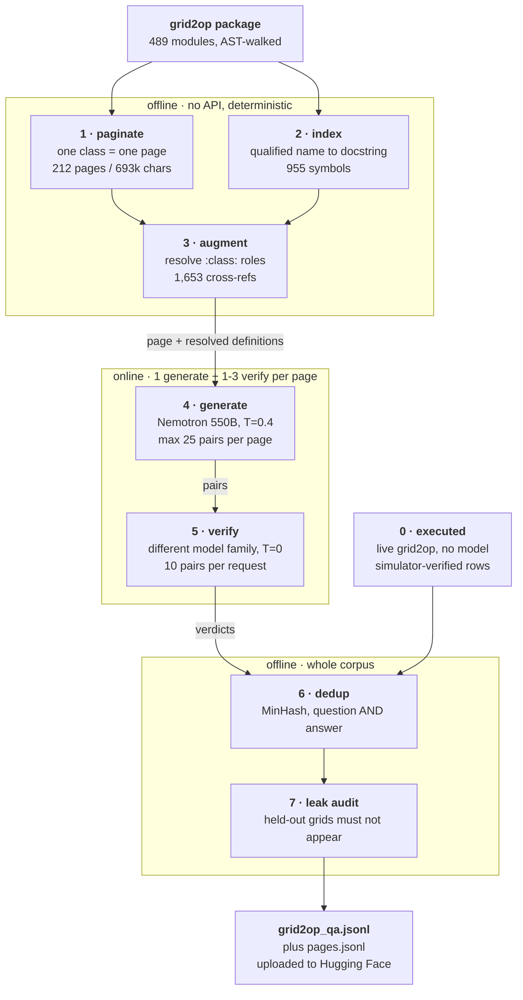
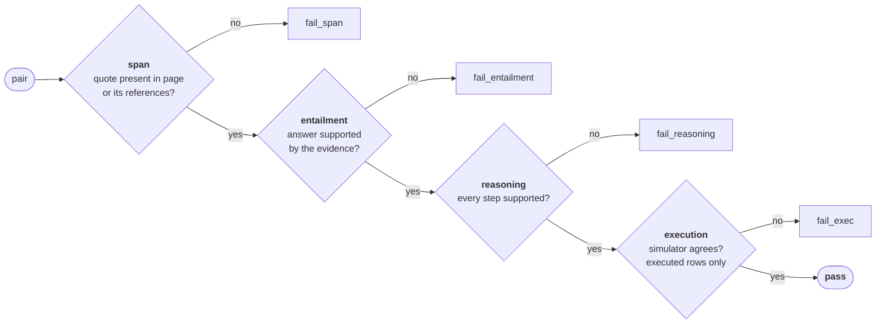

# CASTOR

**CAS**cade aware **TO**pology **R**easoning.

A grid2op foundation model that learns cascade dynamics from sensor data,
explains why a topology fails, and outputs bus configurations that keep the
grid alive. The simulator is ground truth throughout.

The baseline to beat is the LLM guided Safety SAC work, which uses a frozen
Qwen 2.5 7B to clean the replay buffer every 200 training steps. It has no
world model and no transfer across grids. Both of those are where CASTOR lives.

The research plan, the module layout and the risk list live in `docs/`, which
is kept local rather than committed. Ask for a copy if you are picking this up.

## Layout

    configs/        one directory per phase, plus envs/ and experiment/
      envs/         train.yaml and heldout.yaml, the single source of the split
      data/         the three Phase 0 dataset configs
      rag/          rag.yaml and prompts.yaml, the Phase 2 corpus pipeline
      experiment/   the ablation that runs through every phase
    src/castor/
      naming.py     stable element names, shared by both channels
      envs/         grid2op construction, opponent, near-congestion chronics
      data/         phase 0: transitions, cascade logs, oracle actions
      encoder/      phase 1: element encoder
      language/     phase 2: size arms and domain adaptation
      rag/          phase 2: the grid2op QA corpus pipeline
      align/        phase 3: cross attention and the grounding tasks
      dynamics/     phase 4: cascade surrogate -> paper 1
      reasoning/    phases 5 and 6: explanation, then verification
      action/       phase 7: bus configuration head
      deploy/       phase 8: GridStar integration -> paper 2
      eval/         exit tests, held-out guard, ablation harness
    scripts/        every dataset and number regenerates from here
    tests/          unit tests, plus the held-out guard as an integration test

Not committed: data/ and experiments/ (generated), docs/, papers/ and
notebooks/ (local working material).

## Two tracks run through every phase

**The ablation.** At 50M, 100M and 300M: one arm from the language checkpoint,
one from random initialisation. Same encoder, same data, same budget. Reported
at Phase 4 and again at Phase 7. If the language arm does not win, that is a
result worth publishing and it saves a year.

**The held-out grids.** Every exit test runs on grids the model never saw.
That is the only number that supports the word foundation.

## Install

    pip install -e ".[train,dev]"

## Where to start

Phase 0. Start `scripts/gen_oracle.py` first, because it runs for months and
Phase 7 blocks on it. Before generating a single transition, name the two
held-out environments in `configs/envs/heldout.yaml`: changing that split
later invalidates every transfer number.

---

# RAG for CASTOR

Phase 2 domain adaptation. The language arm is a Qwen 2.5 checkpoint that
knows English and arithmetic but has never heard of `obs.rho`, `topo_vect` or
a substation bus assignment. This pipeline reads grid2op's own source and
writes a question, a derivation and an answer for each thing it finds, each
anchored to a verbatim quote from the text it came from.

It is a retrieval-augmented generation system in the literal sense and not the
usual one: documents are retrieved and placed in a teacher's context, but the
retrieval is exact-name symbol lookup rather than embedding similarity, and
the output is a labelled dataset rather than an answer to a user.

The corpus doubles as the groundwork for RLAIF. See
[Why this is RLAIF groundwork](#why-this-is-rlaif-groundwork).

## Why retrieval at all, and why not embeddings

A grid2op docstring is written for a reader who can follow a link:

    ActionSpace should be created by an :class:`grid2op.Environment.Environment`
    with its parameters coming from a properly set up
    :class:`grid2op.Backend.Backend`

Hand that to a teacher model on its own and it will invent what `Backend`
does, confidently and plausibly. 1,653 such cross-references appear across
170 of 212 pages — roughly 60% of docstrings, 2.4 references each. Without
resolution, the majority of pages are being read with their nouns missing.

The retrieval is a **symbol index**: a table from a qualified name to its
docstring, built once by walking the AST. No embeddings, no vector store, no
chunk overlap.

The reason is that a cross-reference is an **exact name**. `BaseObservation.simulate`
means that method on that class and nothing else. Similarity search answers
"what text resembles this string", which is the wrong question and fails in
the specific way that matters: `Environment.step`, `BaseAction.step` and
`Backend.step` all look alike to an embedding, and handing the teacher the
wrong `step` produces a confident definition for a different object. Missing
beats guessing, so an ambiguous lowercase name resolves to nothing rather than
to its first match (`index.bare_fallback_for_qualified: false`).

Measured ambiguity in grid2op: class names are 282 distinct with 3 ambiguous
(1.1%); method names are 545 distinct with 112 ambiguous (20.6%) — `reset`
alone is defined on 24 classes. Hence the rule: a CapWords name may fall back
to a bare lookup, a lowercase one may not.

## Architecture

Every stage before 4 and after 5 is deterministic and free. That is deliberate:
the expensive, rate-limited part is two stages wide, and everything else can be
re-run, measured and debugged without spending a request.

The run is resumable. Rows append per request with an `fsync`, and a restart
skips any page already recorded in `pages.jsonl`, so a dropped session or an
exhausted daily allowance costs one request rather than the run.

## How the data is chunked

**A page is one class.** Not a fixed token window, not a sliding window with
overlap. A grid2op class plus its methods is a semantic unit written by one
author about one object, and a question about it has a natural boundary. Fixed
windows cut a method signature in half and produce questions about fragments.

    class BaseAction          ~94,000 chars of docstrings
    |
    +-- split at pages.max_chars = 24,000, on method boundaries
        |
        +-- BaseAction#1   23,622 chars   ->  1 generate + 3 verify requests
        +-- BaseAction#2   23,968 chars
        +-- BaseAction#3   23,931 chars
        +-- BaseAction#4   22,213 chars

The distribution is heavily skewed, which drives most of the tuning:

    pages                 212          (244 on newer grid2op — see Reproducibility)
    total text        693,334 chars
    mean                3,270 chars
    median                900 chars     <- half the corpus is tiny
    max                23,961 chars
    pages < 1,200 chars    120 of 212   (57%)
    top 10 pages        34% of all text

Three consequences:

- **`min_chars: 120`** drops pages too thin to support a question that is not
  padding.
- **`bundle_under: 0`** — small pages do *not* share a request by default. One
  page per request keeps every pair attributable to one source. Bundling exists
  (`--bundle-under 1500`) and cuts the request count roughly in half, at the
  cost of a teacher that can blur two pages together.
- **`max_pairs_per_page: 25`**, down from 40. Forty pairs of question,
  derivation, answer and verbatim span overran the generator's 16k reply budget
  and the reply was cut mid-object. A median 900-char page cannot support 25
  pairs anyway, and the prompt says fewer is correct: the realised count is
  content-bound, not config-bound.

**Verification chunks separately.** The whole page plus 25 pairs to rule on is
a prompt the free endpoints silently fail to answer — in one run every row from
the four largest pages came back unchecked while every small page was judged.
So the judge sees `max_pairs_per_request: 10` at a time, with indices offset
back onto the page's numbering, and only the referenced definitions that chunk
actually quotes or names (`max_reference_chars: 4000`). Largest verify prompt
is ~33k chars, which the endpoints do answer.

## Models

| role | model | T | why |
|---|---|---|---|
| generate | `nvidia/nemotron-3-ultra-550b-a55b:free` | 0.4 | the teacher; must know more than the student |
| verify | `google/gemma-4-31b-it:free` | 0.0 | a judge should not be creative |
| verify fallbacks | `cohere/north-mini-code`, `recursive/flint-v1.0`, `google/gemma-4-26b-a4b-it` | 0.0 | a `:free` pool is shared with every other user |

**Generator and verifier must be different families.** A model asked to check
its own output agrees with itself, so the entailment check would measure
nothing. Every fallback is a different vendor, so one saturated pool does not
take the others with it.

The student is Qwen 2.5 (0.5B for the ablation arms). Deliberately not in the
teacher chain, for the same reason.

All endpoints are `:free`, which costs nothing and caps the account at 50
requests/day below 10 purchased credits, 1,000 above. A 429 is **counted
against that allowance before it is refused**, so a 429 gets a smaller retry
budget than a timeout (`max_retries_rate_limited: 2` against `max_retries: 4`),
and an exhausted allowance raises immediately rather than being retried per
vendor. The remaining allowance prints before the run rather than being
discovered by running into it.

## The record

One JSON object per line. 16 fields, three of them provenance.

    {
      "id": "g2o-000009",
      "question": "What is the relationship between Environment and ActionSpace?",
      "reasoning": "Environment creates ActionSpace and exposes it as action_space attribute.",
      "answer": "The Environment creates the ActionSpace and exposes it as the
                 action_space attribute for gymnasium compatibility.",
      "support": "action_space: grid2op.Action.ActionSpace\n    Another name for
                  Environment.helper_action_player for gymnasium compatibility.",
      "grounding": "extractive",
      "reasoning_depth": 1,
      "verdict": "pass",
      "checks": {"span": true, "entailment": true, "reasoning": true, "execution": null},
      "span_source": "reference",
      "reason": "",
      "page": "grid2op.Action.actionSpace.ActionSpace",
      "refs": ["Backend", "BaseAction", "BaseRules", "Environment", "GridObjects"],
      "source": "grid2op.api",
      "model": "nvidia/nemotron-3-ultra-550b-a55b:free",
      "verifier": "cohere/north-mini-code:free"
    }

Four fields carry most of the design:

**`support`** is a verbatim span from the evidence. It is what makes a claim
checkable without a model: take the quote, search the text. Everything else a
generator emits is an assertion; this is the one field that can be falsified
mechanically.

**`reasoning`** is the derivation from the span to the answer, kept separate
from the conclusion so the two can be judged separately. An empty string means
a plain lookup, and the prompt forbids manufacturing a derivation to fill the
field. `reasoning_depth` is 0 for a lookup, 1 for a single inference, 2+ for a
chain — and is forced to 0 when `reasoning` is empty, because a depth the text
does not support is a claim rather than a fact.

**`span_source`** is `page`, `reference`, `executed` or empty. The teacher is
shown the page *and* the definitions it refers to, and is told an answer may
rest on either, so a span quoting a definition is correct — but it is a weaker
claim, because it additionally depends on the retrieval layer having resolved
the right symbol. The corpus states which, rather than silently accepting both.

**`verifier`** is the model that *actually* judged, not the configured primary.
When the primary is rate-limited the chain falls through, and a row claiming to
have been judged by a model that never saw it would make the corpus unauditable.

Rows that fail verification **ship with their verdict rather than being
dropped**, so the corpus states its own error rate. Train on `verdict == "pass"`.

## Evaluation

Four gates, cheapest first. Two need no model at all.

- **span** — string search, no request. Exact containment after whitespace
  normalisation, falling back to longest-common-block at `span_min_ratio: 0.90`
  because models trim articles when copying.
- **entailment** and **reasoning** — one request per chunk, shared. The judge
  sees the evidence and the pairs, and *not* how they were produced: not the
  generator's prompt, not its grounding label. Withholding those is what stops
  the verifier being led down the path that produced the error.
- **execution** — the `executed` rows are generated against a live
  `l2rpn_wcci_2022` environment, where the answer is a measured array shape or
  a count rather than a claim. No model, no API key, and the strongest grounding
  tier in the corpus.

A correct answer reached by an unsupported step fails on **reasoning** despite
being right. That is intentional: a wrong answer is one bad fact, while a wrong
derivation is a bad rule the student will apply again to inputs it has never
seen.

Then **dedup** (MinHash over 4-character shingles, 64 permutations, Jaccard
0.80) requiring *both* question and answer similarity — `shape of obs.rho` and
`shape of obs.gen_p` are 93% similar strings stating different facts — and the
**leak audit**, which fails the run if any held-out grid is named anywhere in
the corpus. A held-out grid reaching the student through the text channel makes
every transfer number in the paper unsupportable.

### Measured

Each run after a round of fixes, same pages, same prompts:

| | run 1 | run 2 | run 3 | run 4 |
|---|---|---|---|---|
| pages attempted | 14 | 20 | 11 | 6 |
| pages yielding nothing | **8 (57%)** | 7 (35%) | 0 | **0** |
| rows | 150 | 267 | 185 | 130 |
| rows checked | 47% | 59% | 98% | 85% |
| `fail_span` of checked | 25% | 27% | 27% | **3.6%** |
| pass rate of checked | 63% | 74% | 69% | **95%** |

Current run 4 detail:

    verdict      pass 105, fail_span 4, fail_entailment 2, unchecked 19
    span_source  page 109, reference 16, none 5
    depth        0: 30, 1: 99, 2: 1

The 19 unchecked are not wrong rows: 10 were a verifier reply that would not
parse and 9 were the daily allowance running out mid-page. Both are recoverable
with `--reverify`, which re-judges without paying the generator again.

Projecting run 4 over the full 244 pages: **~5,300 rows, ~4,270 passing**.

### What each round of fixes was worth

The gates are not decoration — every one of these was found by a verdict
disagreeing with an assumption.

- **Retrieval resolved zero of 2,201 cross-references.** `clean()` stripped
  Sphinx markup before `extract_refs()` ran, so the whole retrieval layer was a
  silent no-op that still "worked". Refs are now harvested from raw text.
- **The index dropped the class from method names.** `ast.walk` flattened
  `module.Class.method`, so `BaseObservation.simulate` resolved to a *different
  class's* `simulate`.
- **8 of 14 pages lost to a greedy regex.** `r"\{.*\}"` with DOTALL matched from
  the first brace in the reply to the last; the generator is a reasoning model
  whose thinking block quotes the schema, so the match began inside its notes.
  Replaced with a brace-depth scan that ignores braces inside string literals.
- **Truncated replies cost whole pages.** A reply cut at `max_tokens` has no
  closing brace, so the envelope never parses — but the objects written before
  the cut are complete. They are now reassembled into an envelope.
- **A failed page counted as done.** `done_pages` recorded every id it found, so
  a parse defect marked 8 pages permanently finished. `--retry-failed` releases
  pages whose *reply would not parse* and keeps those that parsed with nothing
  usable: the first is transient, the second means the page is too thin.
- **27% `fail_span` was our own contradiction.** The prompt permitted an answer
  grounded in a referenced definition, then the span check searched only the
  page — and the judge was shown only the page, so a fixed span check would
  merely have moved the failure to `fail_entailment`. Both gates now take the
  page plus the references actually sent. That one change took `fail_span` from
  27% to 3.6%.

## Why this is RLAIF groundwork

The corpus is not only training text. Four properties make it a reward signal.

**Failures are kept, with a per-axis verdict and a critique.** A row carries
`checks` (span / entailment / reasoning / execution, independently) and `reason`,
a short natural-language clause naming what is unsupported. That is exactly the
shape a reward model or a critic needs: `(question, reasoning, answer) -> label
+ reason`. Most pipelines discard rejected generations and so cannot train a
critic later.

**Part of the reward is verifiable, not preferential.** The span check is a
string search and the execution check runs the simulator. Neither is a model's
opinion, so those labels cannot drift with the judge. This is the RLVR end of
the spectrum and it anchors the softer entailment and reasoning labels.

**The feedback is not self-preference.** Generator and verifier are different
families by construction, and `verifier` records which model actually ruled on
each row. A preference dataset where one model judges its own samples measures
style agreement; this one does not.

**The failure modes are separated.** `fail_reasoning` is distinct from
`fail_entailment` — a right answer with a broken derivation is labelled as
such. A reward model trained on a single scalar cannot learn that distinction,
and it is the distinction CASTOR's Phase 5/6 explanation work turns on.

What is still missing for RLAIF proper: paired preferred/rejected completions
for the *same* question. Today a failed row is not matched to a passing one, so
the corpus supports reward-model and critic training but not direct preference
optimisation without a further pairing pass.

## Running it

Everything lives in `configs/rag/rag.yaml` and `configs/rag/prompts.yaml`. No
module reads a literal that is not in one of those two files. The flags below
override single values for one run; they do not replace the file.

    # what the run would do, and what it costs. No API calls.
    python scripts/build_rag_corpus.py --dry-run

    # a small slice first, to see the output before committing the allowance
    python scripts/build_rag_corpus.py --limit 10 --out-dir data/rag_test

    # the run
    export OPENROUTER_API_KEY=sk-or-...        # or put it in .env
    python scripts/build_rag_corpus.py --hf-repo <user>/castor-grid2op-qa

    # recover rows the judge could not be reached for, days later if need be
    python scripts/build_rag_corpus.py --reverify

    # simulator-grounded rows only. No API key, needs the environment downloaded
    python scripts/build_rag_corpus.py --executed-only

    # re-run dedup and the leak audit over the corpus on disk
    python scripts/build_rag_corpus.py --finalise-only

Useful flags: `--no-executed` (skip stage 0, avoids a multi-hundred-MB
environment download), `--retry-failed`, `--bundle-under 1500`, `--max-pairs`,
`--generator` / `--verifier`, `--held-out` (repeatable), `--push-every`.

The corpus uploads every `push_every: 20` requests as well as at the end, so a
killed session costs 20 requests rather than the run.

### Reproducibility

**Page ids depend on the grid2op version.** 1.9.1 produces 212 pages and 955
symbols with ids like `grid2op.Action.ActionSpace.ActionSpace`; a newer release
produces 244 pages, 1,113 symbols and `grid2op.Action.actionSpace.ActionSpace`.
Module file names differ in case, so a corpus built across two versions cannot
resume, dedup or audit correctly. **Generate on one machine, with grid2op
pinned.**

## Known limits

- **`audit.held_out_environments` is empty** and the pipeline warns on every
  run. Until the split is named, stage 7 passes everything. Candidates measured:
  `l2rpn_case14_sandbox` (14 substations), `l2rpn_wcci_2020` (36), against the
  training grid `l2rpn_wcci_2022` (118).
- **The configured verifier has never answered.** Across four runs, every row
  was judged by the first fallback — `google/gemma-4-31b-it:free` returned 429
  on every request. `rag.yaml` currently names a verifier that does not run.
- **`reasoning_depth` is self-assigned by the generator** and the verifier
  checks whether a derivation is *supported*, never whether it is *deep*. Run 4
  produced 1 depth-2 row in 130 against a 25% target. Part of that is page mix —
  run 4 was five `BaseAction` parts, which are attribute tables — and part may
  be a prompt change. Unresolved.
- **4 remaining `fail_span` rows abbreviate with an ellipsis**, quoting a
  docstring attribute table in pieces. The span check demands one contiguous
  block. Faithful quotes, failed on form.
- **Narrative docs are not included.** `source.rst_dir` is unset, so only
  docstrings from the installed package are read. The Sphinx `docs/` directory
  needs a repository clone and holds the concept-level prose — action semantics,
  the opponent model, the rules — which is what the corpus most lacks.
